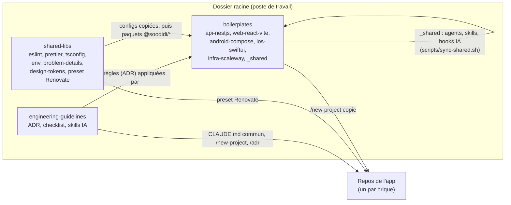
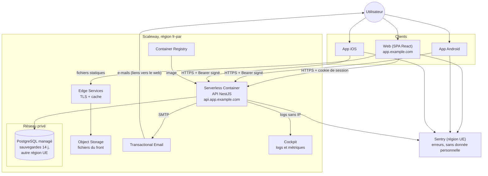
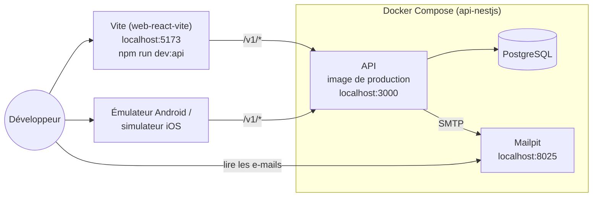
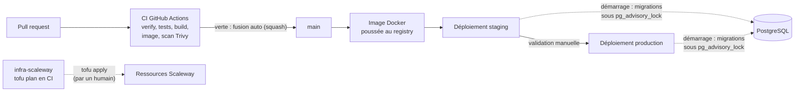
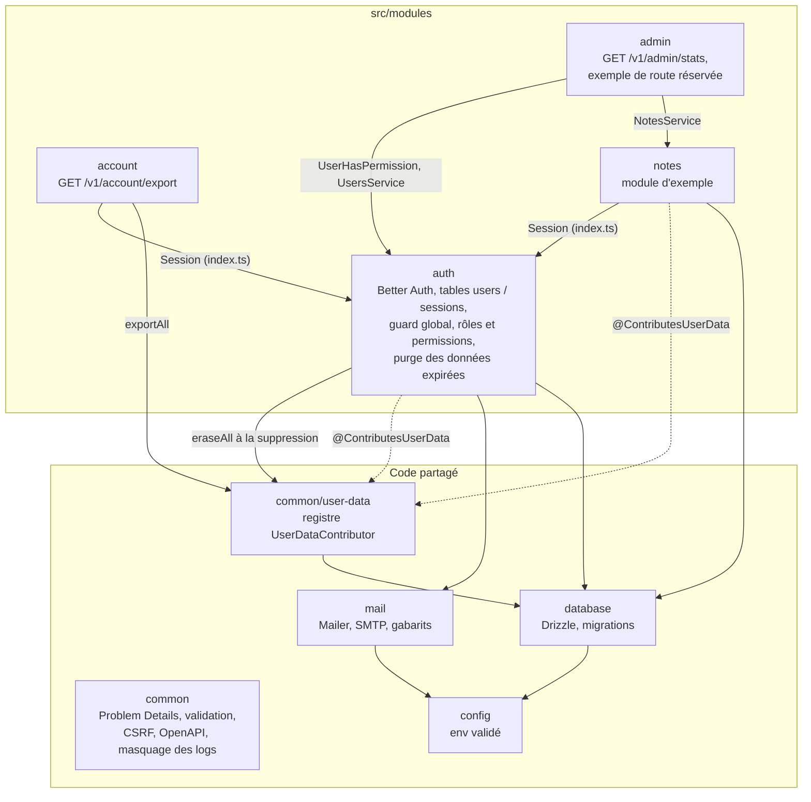
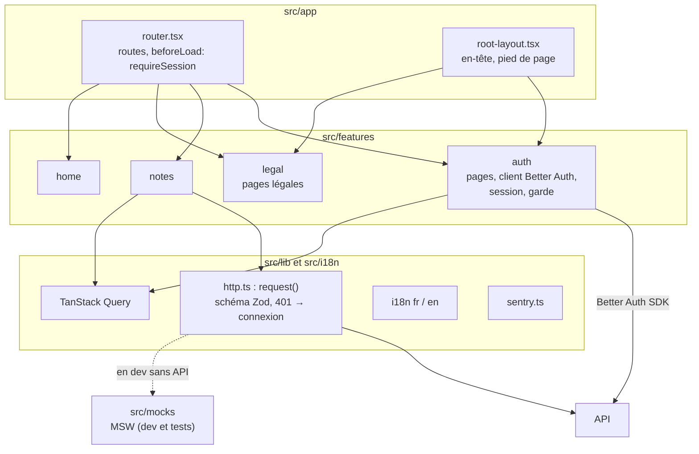
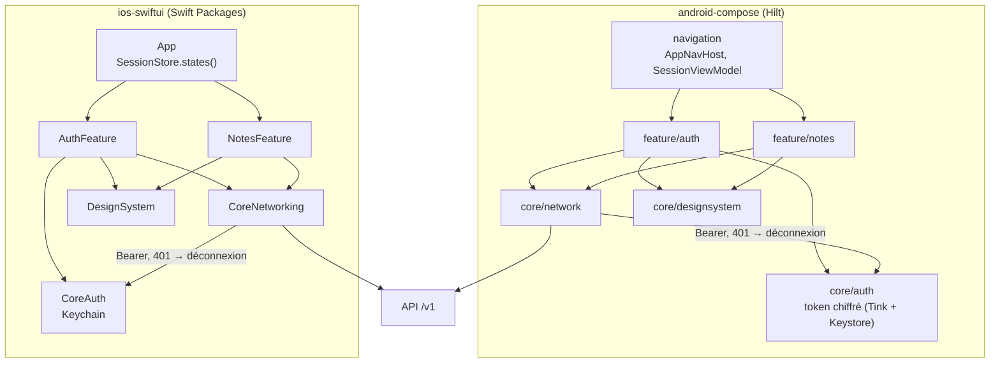
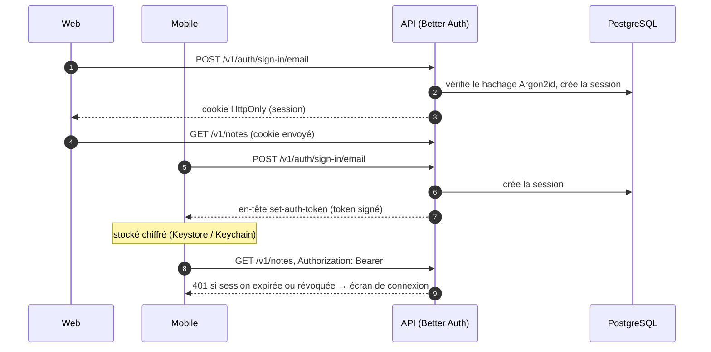
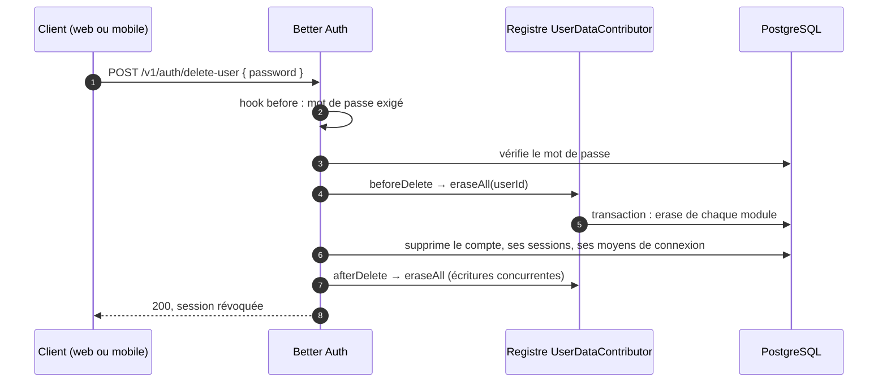
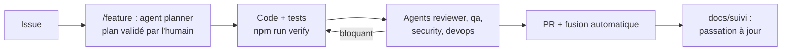

# Architecture : comment tout s'emboîte

Ce document montre, en schémas, comment les repos, les briques d'une app et les services s'articulent. Il décrit l'état des boilerplates ; chaque section renvoie aux ADR qui fixent les règles. Les diagrammes sont en [Mermaid](https://mermaid.js.org/) : GitHub les affiche directement.

À tenir à jour dans la même PR que tout changement qui modifie une flèche : nouveau service, nouvelle brique, nouveau flux de données.

## 1. Les trois repos et une app générée

Les règles viennent d'`engineering-guidelines`, le code de départ de `boilerplates`, les configurations communes de `shared-libs`. `/new-project` copie les boilerplates choisis dans les repos d'une nouvelle app ([GLB-010](../adr/global/GLB-010-boilerplates-et-libs-partagees.md)).

- Un boilerplate reste autonome : il s'installe, se teste et se construit seul.
- Une amélioration trouvée dans une app remonte au boilerplate par `/upstream`.
- Le kit IA (agents `planner`, `reviewer`, `qa`, `security`, `devops`, skills `/feature`, `/fix`, `/review`) vit dans `boilerplates/_shared` et est recopié dans chaque boilerplate ([GLB-011](../adr/global/GLB-011-developpement-avec-l-ia.md)).

## 2. Une app en production

Ce qui tourne quand l'app est déployée, et qui parle à qui ([OPS-005](../adr/devops/OPS-005-hebergement-scaleway.md)).

- Le front et l'API partagent le même domaine, pour que le cookie de session parte ([BE-006](../adr/backend/BE-006-authentification-et-securite.md)).
- La base n'est joignable que depuis le réseau privé ; l'API y applique ses migrations au démarrage, sous verrou ([BE-003](../adr/backend/BE-003-donnees-drizzle-et-migrations.md), [OPS-004](../adr/devops/OPS-004-environnements-et-deploiement.md)).
- Les secrets (URL de la base, secret Better Auth, SMTP) sont injectés dans le conteneur depuis OpenTofu ([OPS-006](../adr/devops/OPS-006-gestion-des-secrets-en-production.md)).
- Ce que chaque service reçoit comme données personnelles est listé dans la politique de confidentialité du web ([GLB-013](../adr/global/GLB-013-donnees-personnelles-et-rgpd.md)).

## 3. En local

`npm run setup && npm run stack` côté API, puis `npm run dev:api` côté web. L'API tourne dans la **même image** qu'en production.

- Sans API, `npm run dev` côté web s'appuie sur les mocks MSW (`src/mocks/`), au même contrat que l'API.
- Les tests de l'API démarrent leur propre PostgreSQL avec Testcontainers ([BE-008](../adr/backend/BE-008-tests-backend.md)).

## 4. De la PR à la production

- Branches courtes, Conventional Commits, fusion automatique quand la CI est verte ([GLB-002](../adr/global/GLB-002-git-trunk-based-et-conventional-commits.md), [OPS-002](../adr/devops/OPS-002-ci-github-actions.md)).
- Le front est construit puis copié dans le bucket ; l'API est une image déployée dans le conteneur ([OPS-001](../adr/devops/OPS-001-conteneurisation-docker.md), [OPS-004](../adr/devops/OPS-004-environnements-et-deploiement.md)).
- L'infra ne change que par `tofu apply`, toujours lancé par un humain ([OPS-003](../adr/devops/OPS-003-infrastructure-as-code.md)).

## 5. Dans l'API

Un module par domaine métier ; un module n'importe que l'`index.ts` d'un autre, jamais ses tables ([BE-002](../adr/backend/BE-002-architecture-modulaire.md)). `npm run arch` le vérifie.

- Une requête passe par : guard d'auth (route protégée par défaut), validation Zod, controller, service, repository ([BE-004](../adr/backend/BE-004-api-rest-et-openapi.md), [BE-005](../adr/backend/BE-005-validation-aux-frontieres.md)).
- Une route réservée porte `@UserHasPermission` ou `@Roles` ; les permissions sont déclarées une seule fois dans `auth/access-control.ts` ([BE-010](../adr/backend/BE-010-roles-et-permissions.md)).
- Toute table avec une colonne `user_id` est couverte par un contributeur du registre, qui l'exporte et l'efface avec le compte ([GLB-013](../adr/global/GLB-013-donnees-personnelles-et-rgpd.md)).

## 6. Dans le web

Code rangé par feature ; une feature n'expose que son `index.ts` ([FE-003](../adr/frontend/FE-003-structure-par-feature.md)).

## 7. Dans les apps mobiles

Même découpage sur Android et iOS : un cœur partagé et des features, au même contrat d'API que le web ([AND-002](../adr/android/AND-002-architecture-udf-mvvm.md), [IOS-002](../adr/ios/IOS-002-architecture-mvvm-observable.md)).

## 8. Parcours clés

### Connexion : web par cookie, mobile par Bearer

Règles : [BE-006](../adr/backend/BE-006-authentification-et-securite.md), [AND-004](../adr/android/AND-004-reseau-donnees-et-securite.md), [IOS-004](../adr/ios/IOS-004-reseau-donnees-et-securite.md).

### Suppression du compte

Règles : [GLB-013](../adr/global/GLB-013-donnees-personnelles-et-rgpd.md). L'export (`GET /v1/account/export`) passe par le même registre.

## 9. Le cycle de travail avec l'IA

Règles : [GLB-011](../adr/global/GLB-011-developpement-avec-l-ia.md). Une décision non couverte par un ADR passe par `/adr` avant d'être codée.
